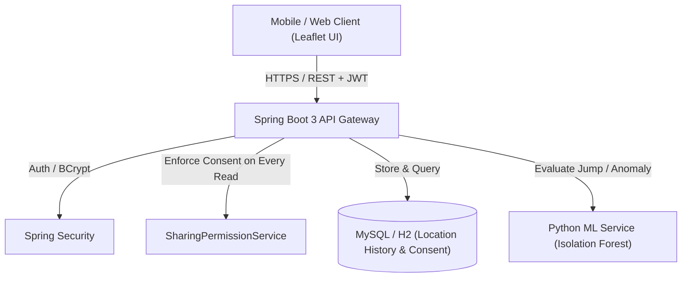

# SafeCircle — Consent-Based Family & Friends Safety Tracker
> **Java · Spring Boot · MySQL · Machine Learning · GPS · Leaflet Maps API**

SafeCircle is a privacy-first location-sharing platform where a user's phone number identifies their registered identity but **never reveals their live coordinates without explicit, active consent**. Users maintain absolute control: live tracking occurs only while an authorized sharing relationship is active, and revoking permission immediately cuts off all subsequent updates.

---

## 🚀 Milestone 1 Implementation (Completed & Verified)

The project includes complete end-to-end implementation and automated integration test coverage for Milestone 1:

1. **User Registration & Authentication**: Registered test users (Alice and Bob) with BCrypt-hashed credentials and HMAC-SHA256 JWT tokens.
2. **Consent-Gated Requests**: User A requests location access to User B via User B's phone number (`POST /api/sharing-requests`). Access is initially `PENDING`.
3. **Strict Privacy Boundary**: User A is strictly forbidden (`403 Forbidden`) from reading User B's coordinates while the request is pending.
4. **Owner Approval**: User B explicitly approves the request (`PATCH /api/sharing-requests/{id}/approve`), transitioning the state to `ACTIVE`.
5. **Live GPS Ingestion**: User B submits GPS coordinates, accuracy, and timestamp (`POST /api/locations`).
6. **Authorized Location Reading**: User A retrieves User B's latest live location (`GET /api/contacts/{id}/location`).
7. **Immediate Revocation**: User B revokes permission (`DELETE /api/sharing-permissions/{id}`). User A is immediately blocked (`403 Forbidden`) from all subsequent coordinate updates.

### 🧪 Integration Test Suite
All 9 milestone verification tests run and pass via JUnit 5 and MockMvc:
```bash
cd backend
./mvnw test
```
Result:
```text
[INFO] Running com.safecircle.SafeCircleMilestoneIntegrationTest
[INFO] Tests run: 9, Failures: 0, Errors: 0, Skipped: 0
[INFO] BUILD SUCCESS
```

---

## 📐 System Architecture



---

## 🗄 MySQL Database Schema

The database follows the six-table relational design with explicit foreign keys and query indexing:

- **`users`**: `user_id` (PK), `name`, `phone_number` (unique), `password_hash`, `account_status`, `created_at`
- **`circles`**: `circle_id` (PK), `name`, `created_by` (FK -> users), `created_at`
- **`circle_members`**: `circle_id` (FK), `user_id` (FK), `role`, `joined_at` (Composite PK)
- **`sharing_permissions`**: `permission_id` (PK), `owner_id` (FK -> users), `viewer_id` (FK -> users), `status`, `approved_at`, `revoked_at`, `expires_at`
- **`location_history`**: `location_id` (PK), `user_id` (FK -> users), `latitude`, `longitude`, `accuracy_m`, `recorded_at` *(Indexed on `user_id`, `recorded_at DESC`)*
- **`safety_checkins`**: `checkin_id` (PK), `user_id` (FK -> users), `destination_label`, `due_at`, `status`, `confirmed_at`, `created_at`
- **`safety_alerts`**: `alert_id` (PK), `user_id` (FK -> users), `alert_type`, `severity`, `status`, `created_at`, `details`

*The full DDL is located in [`backend/src/main/resources/schema.sql`](file:///c:/Users/ssami/Downloads/locationporject/backend/src/main/resources/schema.sql).*

---

## 💻 Quick Start & Running Locally

### 1. Run Spring Boot Backend
The backend runs out-of-the-box with zero database installation required (uses H2 in MySQL-mode by default):

```bash
cd backend
./mvnw spring-boot:run
```

Once running:
- **Interactive Web App & Live Map**: Open [http://localhost:8080/](http://localhost:8080/)
- **H2 Database Console**: Open [http://localhost:8080/h2-console](http://localhost:8080/h2-console) (JDBC URL: `jdbc:h2:mem:safecircledb`, user: `sa`, password: empty)

### 2. Pre-Seeded Test Credentials
The application automatically seeds two test personas:
| Persona | Name | Phone Number | Password |
|---|---|---|---|
| **User A (Viewer)** | Alice Walker | `+15551000001` | `Password123!` |
| **User B (Broadcaster)** | Bob Smith | `+15551000002` | `Password123!` |

### 3. Run with Docker Compose (MySQL 8 + Backend + ML Service)
```bash
docker compose up --build
```

---

## 🤖 Machine Learning Anomaly Detection Microservice

Located in [`ml-service/app.py`](file:///c:/Users/ssami/Downloads/locationporject/ml-service/app.py):
- **GPS Jump Detection**: Computes Haversine distance and checks for physically implausible speeds (>140 km/h in city).
- **Isolation Forest Model**: Scikit-learn model trained on speed, elapsed time, and accuracy to detect movement anomalies.
- **REST API**: `POST /predict-anomaly`

Run the ML service independently:
```bash
cd ml-service
pip install -r requirements.txt
python app.py
```

---

## 📄 What to Put on Your Resume

> **SafeCircle — Consent-Based Family Safety & Location Tracking Platform**
> - Developed a Java Spring Boot backend for consent-based location sharing, trusted circles, and real-time safety updates.
> - Designed a MySQL relational database schema for user permissions, GPS history, safety check-ins, and incident records with query indexing on time-series coordinate streams.
> - Integrated an Isolation Forest machine learning anomaly detection service in Python to flag physically implausible GPS jumps and unusual movement deviations using consented location data.
> - Implemented secure REST APIs with Spring Security and JWT, enforcing strict access-control checks on every coordinate lookup to ensure immediate location hiding upon permission revocation.
