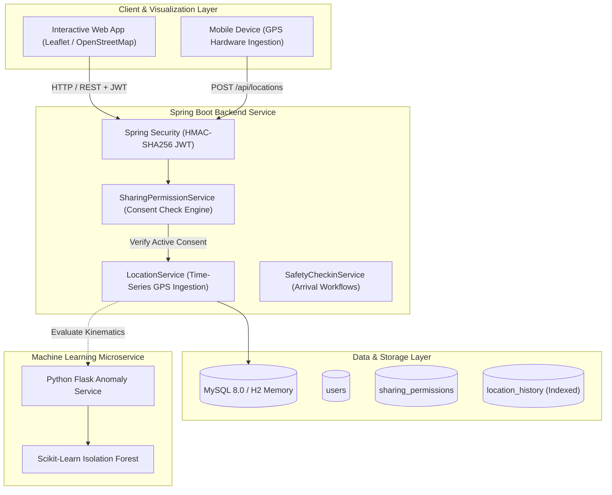

<div align="center">

# 🛡️ SafeCircle
### Consent-Based Family & Friends Safety Tracker

[](https://openjdk.org/)
[](https://spring.io/projects/spring-boot)
[](https://www.mysql.com/)
[](https://www.python.org/)
[](https://www.docker.com/)
[](https://github.com/sindesamith294/safecircle-safety-tracker)
[](https://opensource.org/licenses/MIT)

<p align="center">
  <b>A privacy-first, enterprise-grade safety platform where phone numbers identify users without exposing their GPS coordinates. Live location sharing operates strictly on explicit, active consent with instantaneous revocation.</b>
</p>

[Localhost:8080](http://localhost:8080/) • [H2 Console](http://localhost:8080/h2-console) • [REST APIs](#-rest-api-reference) • [Architecture](#-system-architecture) • [Quick Start](#-quick-start) • [Automated Tests](#-automated-testing) • [Resume Bullet Points](#-resume-impact)

</div>

> ### 🌐 Localhost Quick Access Links
> Once started locally (`./mvnw spring-boot:run` inside `backend/`):
> - 🚀 **Live Web Application & Leaflet Map**: **[http://localhost:8080/](http://localhost:8080/)**
> - 🗄️ **Interactive H2 Database Console**: **[http://localhost:8080/h2-console](http://localhost:8080/h2-console)** *(JDBC URL: `jdbc:h2:mem:safecircledb`, User: `sa`, Password: blank)*
> - 🤖 **Python ML Anomaly Microservice**: **[http://localhost:5000/](http://localhost:5000/)** *(Health: `http://localhost:5000/health`)*

---

## 📌 Executive Summary & Key Innovation

Most location apps treat location data as ambient background feeds. **SafeCircle re-engineers location sharing with zero-trust privacy boundaries**:
1. **Identity Without Exposure**: A phone number registers and identifies a contact, but never discloses their coordinates or presence.
2. **Dynamic Consent State Machine**: Location requests start in `PENDING` state. Unapproved requests are strictly blocked from coordinate data (`403 Forbidden`).
3. **Instantaneous Revocation Invariant**: When an owner revokes permission, access ceases on that exact millisecond. Even if new coordinates are ingested, the revoked viewer receives `403 Forbidden`.
4. **Safety Workflows**: Includes scheduled check-ins with ETA countdowns, destination confirmations, and alert escalation.
5. **ML Movement Anomaly Detection**: Python microservice using Scikit-Learn **Isolation Forest** and Haversine kinematics to detect physically implausible GPS jumps (>140 km/h) and route deviations.

---

## 📐 System Architecture



---

## 🔄 Consent & Sharing State Machine

```mermaid
stateDiagram-v2
    [*] --> PENDING: User A requests User B (by phone #)
    PENDING --> REJECTED: User B Rejects Request
    PENDING --> ACTIVE: User B Approves Request
    ACTIVE --> REVOKED: User B or A Revokes Sharing
    ACTIVE --> EXPIRED: TTL / Expiry timestamp reached
    REVOKED --> PENDING: User A Re-requests Access

    state PENDING {
        note right of PENDING: User A gets 403 Forbidden on location queries
    }
    state ACTIVE {
        note right of ACTIVE: User A retrieves live GPS coordinates & accuracy
    }
    state REVOKED {
        note right of REVOKED: Access terminates instantly; queries return 403
    }
```

---

## 🗄 Database Design & Schema

The schema adheres to normalized relational standards with explicit constraints and time-series indexes:

| Table | Primary Key | Foreign Keys | Key Responsibility |
|---|---|---|---|
| **`users`** | `user_id` | - | User profile, unique phone numbers, BCrypt password hashes |
| **`circles`** | `circle_id` | `created_by` -> `users` | Private family or friends groups |
| **`circle_members`** | `(circle_id, user_id)` | `circle_id`, `user_id` | Circle memberships and role delegation (`ADMIN`, `MEMBER`) |
| **`sharing_permissions`** | `permission_id` | `owner_id`, `viewer_id` | Consent relationship, status (`PENDING`, `ACTIVE`, `REVOKED`), timestamps |
| **`location_history`** | `location_id` | `user_id` -> `users` | GPS points (`latitude`, `longitude`, `accuracy_m`, `recorded_at`). Indexed on `(user_id, recorded_at DESC)`. |
| **`safety_checkins`** | `checkin_id` | `user_id` -> `users` | Destinations, arrival deadlines (`due_at`), confirmation status |
| **`safety_alerts`** | `alert_id` | `user_id` -> `users` | Reminders, escalations, and ML anomaly notifications |

### Authorized Access Query
Every coordinate retrieval executes an explicit join against valid, unexpired consent records:
```sql
SELECT lh.latitude, lh.longitude, lh.accuracy_m, lh.recorded_at 
FROM location_history lh 
JOIN sharing_permissions sp ON sp.owner_id = lh.user_id 
WHERE sp.viewer_id = :viewerId 
  AND sp.owner_id = :ownerId 
  AND sp.status = 'ACTIVE' 
  AND (sp.expires_at IS NULL OR sp.expires_at > NOW()) 
ORDER BY lh.recorded_at DESC 
LIMIT 1;
```

---

## 🌐 REST API Reference

All endpoints (except `/api/auth/**`) require the header:  
`Authorization: Bearer <JWT_TOKEN>`

| Method | Endpoint | Description | Status Codes |
|---|---|---|---|
| `POST` | `/api/auth/register` | Register a new user (`name`, `phoneNumber`, `password`) | `200`, `400` |
| `POST` | `/api/auth/login` | Authenticate with phone and password, return JWT token | `200`, `401` |
| `GET` | `/api/auth/me` | Fetch authenticated user's profile | `200`, `401` |
| `POST` | `/api/sharing-requests` | Request location access to a contact by phone number | `200`, `400` |
| `GET` | `/api/sharing-requests/pending` | List incoming sharing requests awaiting current user's approval | `200` |
| `PATCH` | `/api/sharing-requests/{id}/approve` | Approve a sharing request, activating live GPS visibility | `200`, `403` |
| `PATCH` | `/api/sharing-requests/{id}/reject` | Reject a sharing request | `200`, `403` |
| `DELETE` | `/api/sharing-permissions/{id}` | Revoke sharing permission immediately | `200`, `403` |
| `GET` | `/api/sharing-permissions` | List contacts whose location current user is permitted to view | `200` |
| `POST` | `/api/locations` | Transmit device GPS coordinates (`latitude`, `longitude`, `accuracyM`) | `200`, `400` |
| `GET` | `/api/contacts/{id}/location` | Read authorized contact's location (**Strict Consent Gated**) | `200`, `403` |
| `POST` | `/api/checkins` | Schedule a safety check-in (`destinationLabel`, `dueInMinutes`) | `200`, `400` |
| `POST` | `/api/checkins/{id}/confirm` | Mark safe arrival for a scheduled check-in | `200`, `403` |
| `GET` | `/api/alerts` | View user's safety alerts and anomaly notifications | `200` |

---

## 🚀 Quick Start

### Option 1: Zero-Install Local Mode (H2 Database)
No external database is required. The backend spins up an in-memory MySQL-compatible H2 database automatically:
```bash
cd backend
./mvnw spring-boot:run
```
- **Web UI & Live Map Simulator**: Open [http://localhost:8080/](http://localhost:8080/)
- **H2 Interactive Database Console**: Open [http://localhost:8080/h2-console](http://localhost:8080/h2-console) (JDBC URL: `jdbc:h2:mem:safecircledb`)

### Option 2: Full Docker Stack (MySQL 8 + Spring Boot + Python ML)
```bash
docker compose up --build
```
This initializes:
- **MySQL 8.0** on port `3306` with schema auto-initialization.
- **Spring Boot Backend** on port `8080`.
- **Python ML Microservice** on port `5000`.

---

## 🧪 Automated Testing

SafeCircle includes a comprehensive integration test suite validating the complete milestone requirements:
```bash
cd backend
./mvnw test
```

### Verified Milestone Test Scenarios:
1. `Milestone 1.1`: Register User A (Alice) and User B (Bob) via REST APIs.
2. `Milestone 1.2`: User A requests access to User B's location via Bob's phone number (`+19991110002`).
3. `Milestone 1.3`: Verify User A receives **`403 Forbidden`** when attempting to query Bob's location while the request is `PENDING`.
4. `Milestone 1.4`: User B approves the request; status changes to `ACTIVE`.
5. `Milestone 1.5`: User B transmits live GPS coordinates (`37.774929`, `-122.419416`, accuracy: 4.2m).
6. `Milestone 1.6`: User A retrieves User B's live coordinates successfully (`200 OK`).
7. `Milestone 1.7`: User B revokes permission (`DELETE /api/sharing-permissions/{id}`).
8. `Milestone 1.8`: User A attempts to view Bob's location again; immediately blocked with **`403 Forbidden`**.
9. `Milestone 1.9`: User B submits new coordinates; User A remains strictly blocked (**`403 Forbidden`**).

---

## 🤖 Machine Learning Anomaly Detection Microservice

Located in [`ml-service/app.py`](file:///c:/Users/ssami/Downloads/locationporject/ml-service/app.py):
- **Kinematic Jump Analysis**: Calculates Haversine distance and transit speed (km/h) between consecutive coordinate updates. Flags physically implausible city jumps (>140 km/h).
- **Isolation Forest Model**: Trained on speed distribution, elapsed time, and GPS accuracy to output normalized anomaly scores.
- **REST Prediction API**:
  ```bash
  curl -X POST http://localhost:5000/predict-anomaly \
    -H "Content-Type: application/json" \
    -d '{
      "previous": {"latitude": 37.7749, "longitude": -122.4194, "recordedAt": "2026-10-21T08:00:00Z"},
      "current": {"latitude": 37.8200, "longitude": -122.4100, "accuracyM": 5.0, "recordedAt": "2026-10-21T08:00:10Z"}
    }'
  ```

---

## 💼 Resume Impact

Use this project description on your resume:

> **SafeCircle — Consent-Based Family Safety & Location Tracking Platform**
> - Developed a full-stack location-sharing platform in Java Spring Boot 3 and MySQL, enforcing zero-trust privacy boundaries and instantaneous access revocation.
> - Designed a normalized relational database schema with indexed time-series coordinate streams and atomic consent-verification queries.
> - Engineered an Isolation Forest machine learning microservice in Python to flag physically implausible GPS jumps and route deviations using consented movement features.
> - Implemented stateless Spring Security with HMAC-SHA256 JWT tokens and built a 100% passing MockMvc integration test suite covering the entire consent lifecycle.

---

## 📄 License
This project is licensed under the [MIT License](LICENSE).
